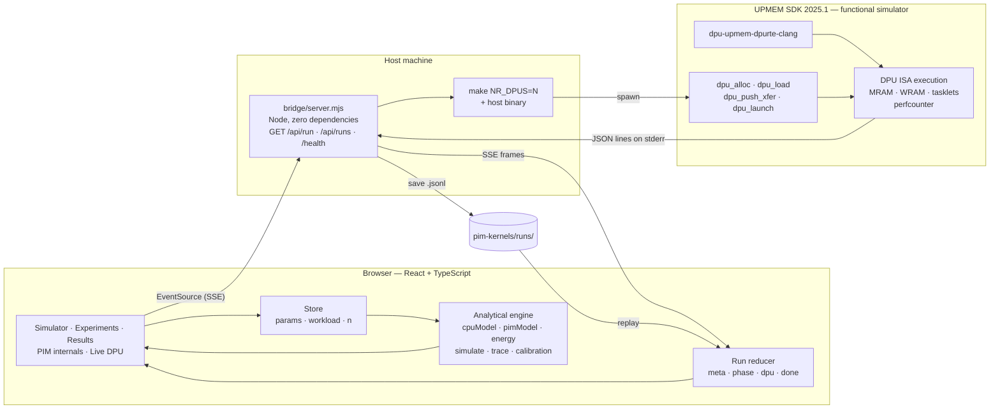
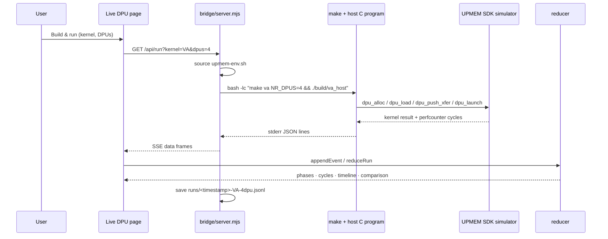

# PIM Architecture Simulator & Real UPMEM Kernels

An interactive CPU-vs-Processing-in-Memory (PIM) performance and energy
explorer, plus a set of kernels that execute on the **real UPMEM DPU
instruction set**. This is the course project for **Advanced Computer
Architecture**: *Processing-in-Memory (PIM) Architecture Simulator and
Performance Analysis*.

The central question:

> For a given workload and memory configuration, when does PIM beat a
> conventional CPU, by how much, and what limits it?

The project answers that question in two independent ways:

1. **An analytical model** you can explore in the browser — every reported
   number is decomposed into the formula that produced it.
2. **Real DPU kernels** compiled with the UPMEM SDK, executed in the SDK's
   functional simulator, and measured with on-chip performance counters. Those
   measurements calibrate the analytical model.

---

## Table of contents

- [What it does](#what-it-does)
- [Quick start](#quick-start)
- [How the system works](#how-the-system-works)
  - [High-level architecture](#high-level-architecture)
  - [Path 1 — analytical simulation](#path-1--analytical-simulation)
  - [Path 2 — real UPMEM execution](#path-2--real-upmem-execution)
  - [Live stream vs replay](#live-stream-vs-replay)
- [The analytical model](#the-analytical-model)
  - [CPU model](#cpu-model)
  - [PIM model](#pim-model)
  - [Energy model](#energy-model)
  - [Derived metrics](#derived-metrics)
  - [Suitability score](#suitability-score)
  - [Presets and workloads](#presets-and-workloads)
- [Real UPMEM DPU execution](#real-upmem-dpu-execution)
  - [The machine](#the-machine)
  - [The three kernels](#the-three-kernels)
  - [Measured results](#measured-results)
  - [Calibration ledger](#calibration-ledger)
- [Dashboard pages](#dashboard-pages)
- [Repository layout](#repository-layout)
- [Setup and build details](#setup-and-build-details)
- [Testing and validation](#testing-and-validation)
- [Five-minute demo](#five-minute-demo)
- [Troubleshooting](#troubleshooting)
- [Limitations](#limitations)
- [References](#references)

---

## What it does

| Capability | Description |
|---|---|
| **CPU vs PIM simulator** | Time, energy, data movement, bandwidth utilisation and speedup for eight workloads, with editable CPU/PIM/energy parameters |
| **Honest cost model** | Includes copy-in, host merge, copy-out, launch, sync, load imbalance and the slow PIM integer multiply — the costs marketing slides omit |
| **Formula inspector** | Symbolic formula → substituted numbers → plain-language explanation for every term, with the critical path marked |
| **Real DPU execution** | Vector add, GEMV and reduction compiled to the UPMEM DPU ISA and executed by the SDK runtime |
| **Calibration** | Measured DPU cycles and transfer times are compared with the model; one click applies measured constants |
| **Live dashboard** | Build and run a kernel from the browser, stream phases over SSE, or replay a saved run offline |
| **PIM Suitability Score** | 0–100 score from four model-derived factors, fitted and validated over ~500 random configurations |
| **Optimiser** | Searches banks × units × frequency under a power budget and reports a Pareto front |
| **Experiments** | Ten guided sweeps (E1–E10) with charts, CSV export and written observations |
| **Learning material** | Built-in explanations of the memory wall, DRAM organisation, roofline and PIM taxonomy |

---

## Quick start

### 1. The dashboard (no UPMEM SDK needed)

```bash
cd pim-simulator
npm install
npm run dev          # http://localhost:5173
```

Production build:

```bash
npm run build        # dist/
npm run preview
npm test             # 23 engine + trace tests
```

### 2. Real DPU kernels (UPMEM SDK required)

```bash
source ../upmem-env.sh          # from the project root; adjusts PATH/LD_LIBRARY_PATH
cd pim-kernels

make va   NR_DPUS=4 && ./build/va_host
make gemv NR_DPUS=4 && ./build/gemv_host
make red  NR_DPUS=4 && ./build/red_host
```

See [`pim-kernels/README.md`](pim-kernels/README.md) for SDK setup, the event
format and portability notes.

### 3. Live mode (dashboard ↔ real DPUs)

```bash
# terminal 1
cd pim-simulator
node bridge/server.mjs          # http://localhost:8787

# terminal 2
cd pim-simulator
npm run dev
```

Open **Live DPU** → pick a kernel and DPU count → **Build & run on DPUs**. The
three bundled demo runs work even with the bridge stopped.

> **No UPMEM board is attached.** Kernels run in the UPMEM SDK **functional
> simulator**, which executes the compiled DPU binary instruction by
> instruction. DPU cycle counts and phase shapes are real measurements of the
> simulator; host wall time is simulation overhead, not silicon time.

---

## How the system works

### High-level architecture



### Path 1 — analytical simulation

This is the default page and needs no server.

```text
User changes a parameter (preset, workload, n, banks, bandwidth, …)
        │
        ▼
store.ts  (single immutable AppState; every action re-derives the result)
        │
        ▼
simulate(params, workload, n)
        ├── workload.computeTotals(n, P)   bytes, ops, multiplies, random accesses,
        │                                   partials, merge ops, syncs
        ├── cpuModel()                      T_stream, T_random, T_compute, max()
        ├── pimModel()                      copy-in, launch, bank/compute kernel,
        │                                   merge, copy-out, sync
        ├── energyModel()                   movement, in-bank, compute, static
        └── derived                         speedup, energy saving, break-even,
                                            arithmetic intensity, phase timeline
        │
        ▼
Result object ──► charts, tables, score, optimiser, roofline, animation
             └──► formulaTrace() ──► step-by-step inspector (PIM internals page)
```

Every UI action triggers a pure recomputation; there is no hidden state in the
engine. The same `simulate()` function is used by the tests, the optimiser, the
suitability validation and the Live page's measured-vs-model comparison.

### Path 2 — real UPMEM execution

The live path crosses from JavaScript to C and back:



The host program emits exactly one JSON object per line on **stderr**; normal
program output stays on stdout so the bridge can forward it separately.

```json
{"event":"meta","kernel":"VA","dpus":4,"tasklets":16,"n":4194304,"ops":4194304}
{"event":"phase","name":"alloc_load","ms":0.61,"bytes":0}
{"event":"phase","name":"copy_in","ms":3.734,"bytes":33554432}
{"event":"phase","name":"launch","ms":423.246,"bytes":0}
{"event":"phase","name":"copy_out","ms":2.548,"bytes":16777216}
{"event":"dpu","cycles":12812752,"dpus":4}
{"event":"done","ok":true,"code":0,"saved":"…-VA-4dpu.jsonl"}
```

`meta.n` is chosen to map 1:1 onto the analytical model's `n` for the same
workload, which is what allows an apples-to-apples comparison of measured DPU
cycles and predicted kernel time at the same configuration.

The window between `phase` events is measured with `CLOCK_MONOTONIC` on the
host; the DPU cycle count comes from `perfcounter_get()` inside the kernel and
is reported as the maximum across all tasklets (the critical tasklet).

### Live stream vs replay

Both paths produce the same event objects and go through the same reducer:

- **Live** — `EventSource` to `bridge/server.mjs`, events appended as they
  arrive.
- **Replay** — a `.jsonl` file from `public/runs/` (bundled demos) or
  `pim-kernels/runs/` (bridge-saved), read and reduced in one pass.

That is why the phase timeline, tables and raw stream look identical whether a
run was just executed or loaded from disk.

---

## The analytical model

All formulas live in `pim-simulator/src/engine/`. Units are seconds, bytes,
operations and joules internally; the UI formats them.

### CPU model

A modern CPU overlaps memory and compute, so the run takes the **longer** of the
two, not their sum:

```text
T_stream  = (B_read + B_written) / BW_mem
T_random  = (R × L) / (cores × MLP)
T_mem     = T_stream + T_random
T_compute = O / (cores × f_CPU × IPC_CPU)
T_CPU     = max(T_mem, T_compute)
```

- `B_read`, `B_written` — all bytes the workload touches (inputs + outputs).
- `R` — uncached/random accesses; `L` — DRAM latency; `MLP` — outstanding misses
  per core.
- `O` — arithmetic operations; `f_CPU` — clock; `IPC_CPU` — instructions retired
  per cycle per core.

The model also counts cache-line-granular accesses (`bytes / 64 + R`) so the
"accesses" metric is not just an element count.

### PIM model

The PIM side is deliberately pessimistic and serial: data must arrive before the
kernel runs, partials must return before the host can merge them.

```text
T_copy-in = B_input / BW_copy                     (0 if data is resident)
T_launch  = launch_us
T_bank    = kernel_bytes / BW_bank + (R / P) × 60 ns
f_mul     = O_mul / O
c         = (1 − f_mul) + f_mul × c_mul           (op-mix correction)
T_pcomp   = (O / P × imbalance × c) / (f_PIM × IPC_PIM)
T_kernel  = max(T_bank, T_pcomp)
T_merge   = (P × partial_bytes) / BW_copy + (P × merge_ops) / 2 Gops/s
T_copy-out= B_output / BW_copy                    (0 if result stays in banks)
T_sync    = syncs × sync_us
T_PIM     = T_copy-in + T_launch + T_kernel + T_merge + T_copy-out + T_sync
```

Important choices:

- **`P`** — total PIM units, `banks × units_per_bank`. Each unit processes
  `n / P` elements, scaled by the workload's `imbalance` factor.
- **`c`** — a multiply is not a free add on UPMEM. The ISA implements 32-bit
  multiply as a software sequence, so multiply-heavy kernels are scaled up.
- **In-bank random latency** is assumed to be 60 ns; the host merge rate is
  assumed to be 2 Gops/s.
- **`T_merge` grows with `P`** — this is why reduction speedup flattens as you
  add units.

### Energy model

```text
CPU:
  E_move    = bytes × offchip_pJ_per_B
  E_in-bank = bytes × inbank_pJ_per_B
  E_compute = O × cpu_pJ_per_op
  E_static  = cpu_static_W × T_CPU

PIM:
  E_move    = bytes_offchip × offchip_pJ_per_B
  E_in-bank = bytes × inbank_pJ_per_B
  E_compute = O × c × pim_pJ_per_op
  E_static  = (cpu_idle_W + P × pim_unit_W) × T_PIM
```

`bytes_offchip` for PIM is **only** copy-in + copy-out + partials; the element
traffic stays inside the memory banks. That is the energy argument for PIM.
Off-chip movement is roughly two orders of magnitude more expensive per byte
than an in-bank access.

### Derived metrics

```text
Speedup          = T_CPU / T_PIM
Energy saving    = (E_CPU − E_PIM) / E_CPU × 100 %
Break-even runs  = (T_copy-in + T_copy-out) / (T_CPU − T_kernel)
Arithmetic int.  = O / (bytes + R × 64 B)
```

Break-even is only defined when data is **not** resident and the PIM kernel is
actually faster than the CPU; otherwise it is reported as `n/a`.

### Suitability score

Four 0–1 factors computed from the model:

| Factor | Meaning |
|---|---|
| `memoryIntensity` | How far below the CPU ridge point the workload sits |
| `parallelism` | `1 − (merge + sync) / T_PIM` — how little time is lost to coordination |
| `dataMovementSaved` | `1 − PIM off-chip bytes / CPU bytes` |
| `computeFit` | `min(1, T_bank / T_pcomp)` — whether the PIM cores keep up with the banks |

Default weights: **0.35 · 0.25 · 0.25 · 0.15**. Weights are fitted with logistic
regression against the label `speedup > 1` over ~500 random configurations, and
the report shows accuracy, Spearman ρ and the best score threshold. The optimiser
searches banks × units × frequency under a power budget and reports the Pareto
front.

### Presets and workloads

| Preset | PIM units | PIM clock | Bank BW | Copy BW | Mul cost |
|---|---:|---:|---:|---:|---:|
| Simple mockup | 8 | 1.0 GHz | 8 GB/s | 25 GB/s | 1× |
| UPMEM-like | 2,560 | 0.35 GHz | 0.63 GB/s | 6 GB/s | 5.7× |
| HBM-PIM-like | 512 | 0.30 GHz | 9.4 GB/s | 1,200 GB/s | 1× |

Workloads: **Vector Add, Vector Multiply, Reduction, Select/Search, GEMV,
GEMM**, plus stretch cases **Histogram** and **BFS**. Each descriptor defines
read/write bytes, operations, multiply share, random accesses, partials, merge
ops and syncs as functions of `n` and `P`.

---

## Real UPMEM DPU execution

### The machine

```text
Host CPU + DRAM
      │  copy-in / copy-out over the SDK runtime
      ▼
┌────────────────────── UPMEM DPU set ──────────────────────┐
│  DPU 0            DPU 1            …            DPU N     │
│  ┌──────────┐     ┌──────────┐                 ┌────────┐  │
│  │ 64 MiB   │     │ 64 MiB   │                 │ 64 MiB │  │
│  │  MRAM    │     │  MRAM    │                 │  MRAM  │  │
│  │ 16 banks │     │ 16 banks │                 │        │  │
│  └────┬─────┘     └────┬─────┘                 └───┬────┘  │
│       │ 256 B DMA      │                           │       │
│  ┌────▼─────┐     ┌────▼─────┐                 ┌───▼────┐  │
│  │ 64 KiB   │     │ 64 KiB   │                 │ 64 KiB │  │
│  │  WRAM    │     │  WRAM    │                 │  WRAM  │  │
│  └────┬─────┘     └────┬─────┘                 └───┬────┘  │
│  ┌────▼─────┐     ┌────▼─────┐                 ┌───▼────┐  │
│  │ 16       │     │ 16       │                 │ 16     │  │
│  │ tasklets │     │ tasklets │                 │tasklets│  │
│  └──────────┘     └──────────┘                 └────────┘  │
└────────────────────────────────────────────────────────────┘
```

Key properties that the model captures:

- **A DPU sits beside a DRAM bank.** Its slice never leaves the memory chip
  during the kernel.
- **No caches.** Data must be staged into WRAM explicitly with `mram_read` /
  `mram_write`; every reuse is a software decision.
- **In-order cores, no vector unit**, ~0.35 GHz, ~58 MOPS per DPU for 32-bit
  adds.
- **Software multiply.** Integer multiply costs several adds — the `c_mul`
  constant in the model.
- **16 hardware tasklets per DPU** share the 64 KiB WRAM; barriers are explicit.
- **256-byte DMA bursts** (8-byte alignment minimum).

### The three kernels

| Kernel | Source | Strategy | What it proves |
|---|---|---|---|
| **VA** `C = A + B` | `pim-kernels/va/` | Each tasklet streams 256 B blocks of A and B, adds, writes C back | Pure streaming: measured time is transfer-shaped, no partials or merge |
| **GEMV** `y = A·x` | `pim-kernels/gemv/` | Matrix rows stay in MRAM; the full `x` vector is staged once into shared WRAM behind a barrier; each tasklet owns whole rows | Multiply-bound: exposes the software-multiply penalty |
| **RED** `sum(D)` | `pim-kernels/red/` | Tasklets sum slices into WRAM, hit a hardware barrier, tasklet 0 combines 16 partials; host merges one partial per DPU | Exercises both `T_sync` and `T_merge` |

The kernels are compiled by:

```bash
dpu-upmem-dpurte-clang -O2 -DNR_TASKLETS=16 ... -o build/va_dpu va/dpu.c
cc va/host.c ... -DNR_DPUS=4 -o build/va_host
```

and launched through the normal SDK host API (`dpu_alloc`, `dpu_load`,
`dpu_prepare_xfer`, `dpu_push_xfer`, `dpu_launch`, `dpu_push_xfer` for results).
After the kernel, the host checks every output element against a CPU reference.

### Measured results

Four DPUs, sixteen tasklets per DPU, `1 << 20` int32 elements per DPU (4 MiB per
array). Cycles are the maximum across tasklets from `perfcounter_get()`.

| Kernel | Logical `n` | Input traffic | DPU cycles | Kernel @ 0.35 GHz | Correctness |
|---|---:|---:|---:|---:|---|
| VA | 4,194,304 | 32 MiB | 12,812,752 | ≈36.6 ms | 0 errors vs CPU |
| GEMV | 4,194,304 | 16 MiB + 4 KiB × 4 broadcast | 27,362,256 | ≈78.2 ms | 0 errors vs CPU |
| RED | 4,194,304 | 16 MiB | 5,375,760 | ≈15.4 ms | sum −1,963,502 matches, 0 errors |

Measured host-side phases for VA: `copy_in` 33.5 MB in **4.37 ms** (≈7.65 GB/s),
`copy_out` 16 MB in 2.55 ms. GEMV and RED copy-in measured ≈2.2 ms for 16 MiB.
The `launch` phase is dominated by instruction-by-instruction simulation and is
deliberately **not** used as a silicon timing estimate.

### Calibration ledger

`pim-simulator/src/engine/calibration.ts` keeps every constant next to its
source, and the **PIM internals** page renders it as a table:

| Constant | Model default | Measured / published | Source |
|---|---:|---:|---|
| Host ↔ DPU copy bandwidth | preset value | **7.65 GB/s** | measured here (DPU sim) |
| Integer multiply cost | preset value | **3.33× an add** | back-solved from GEMV perfcounter |
| Per-DPU MRAM bandwidth | preset value | **0.63 GB/s** | PrIM 2022 |
| DPU clock | preset value | **0.35 GHz** | SDK specification |
| DPU throughput | preset value | **0.166 ops/cycle** | PrIM 2022 |
| Off-chip energy | 160 pJ/B | **160 pJ/B** | Horowitz, ISSCC 2014 |
| Kernel launch | 50 µs | **50 µs** | model assumption |

Pressing **Apply measured values** patches the live parameters, so the simulator,
charts and formula inspector all move to the calibrated configuration together.
The page also compares each real run's measured kernel time with the model's
prediction at the same `P` and `n`, and flags the error.

---

## Dashboard pages

| Page | Contents |
|---|---|
| **Simulator** | Workload/preset/data-size controls, datapath animation, results table, energy and time breakdowns, bank utilisation, suitability card, optimiser |
| **Experiments** | E1–E10 parameter sweeps with charts, CSV download and written observations |
| **Results** | Performance graphs vs data size, roofline, CPU/PIM breakdowns, quick comparison |
| **PIM internals** | DPU/MRAM/WRAM/DMA/tasklet diagram; formula inspector with symbolic formula, substituted numbers and “why this term exists”; calibration ledger; measured-runs table |
| **Live DPU** | Kernel/DPU controls, build-and-run, stop/clear, demo and saved-run replay, file upload, phase timeline/table, measured-vs-model table, raw event stream |
| **Learn** | Memory wall, memory hierarchy, roofline, PIM taxonomy and glossary |
| **About** | Scope, contribution, model limitations and references |

The **PIM internals** formula inspector is generated by
`src/engine/trace.ts`: every step has a formula, a substitution using the
current run's numbers, a value, a unit and an explanation, and the critical-path
and `max()` winners are marked. The trace is covered by tests so the displayed
decomposition always sums back to the aggregate result.

---

## Repository layout

```text
ACA_PROJECT/
├── README.md                     ← this document
├── PIM_Project_Plan.md           project plan, appendices, viva questions
├── upmem-env.example.sh          template for the SDK environment script
├── pim-simulator/                React + TypeScript dashboard
│   ├── src/engine/               params · workloads · cpuModel · pimModel
│   │                             energy · simulate · trace · calibration
│   │                             sweep · suitability · optimizer · format
│   ├── src/components/           charts, tables, roofline, architecture view
│   ├── src/pages/                Simulator · Experiments · Results · Deep
│   │                             Live · Learn · About
│   ├── src/state/                store · hooks · live (SSE + replay)
│   ├── bridge/server.mjs         zero-dependency SSE bridge to the kernels
│   ├── public/runs/              bundled demo streams (VA, GEMV, RED @ 4 DPUs)
│   ├── tests/                    engine.test.ts · trace.test.ts
│   ├── docs/model-spec.md        model specification
│   └── notes/                    development notes
└── pim-kernels/                  real UPMEM DPU programs
    ├── common/                   shared constants, result structs, event emitters
    ├── va/  gemv/  red/          DPU kernel + host program for each workload
    ├── runs/                     replayable measured event streams
    ├── Makefile                  make va | gemv | red | all | run_*
    └── README.md                 kernel-specific build and portability notes
```

---

## Setup and build details

### Dashboard

Requirements: Node.js 18+ and npm.

```bash
cd pim-simulator
npm install
npm run dev
```

Environment overrides:

- `VITE_BRIDGE_URL` — bridge base URL (default `http://localhost:8787`).
- `PORT` — bridge port (default `8787`).
- `UPMEM_ENV` — path to the SDK environment script used by the bridge.

### UPMEM SDK

The kernels require **UPMEM SDK 2025.1** (`dpu-upmem-dpurte-clang`, `libdpu`,
`dpu-pkg-config`) and a host Python shared library for `libdpu`. The SDK is not
vendored in this repository. Create the environment script from the template:

```bash
cp upmem-env.example.sh ../upmem-env.sh
# edit UPMEM_HOME to your SDK extraction path
source ../upmem-env.sh
```

The script selects simulator mode and appends any compatibility libraries needed
on distributions newer than the SDK's Ubuntu 20.04 target.

Build:

```bash
cd pim-kernels
make va NR_DPUS=4
make gemv NR_DPUS=4
make red NR_DPUS=4
# or: make all NR_DPUS=16
```

Binaries land in `pim-kernels/build/`. The Makefile **always recompiles** the
selected kernel because `NR_DPUS` is baked into the host allocation and launch
width; reusing a binary from a different DPU count would silently run the wrong
configuration.

Run with the event stream:

```bash
make run_va NR_DPUS=4      # build/va_events.jsonl
PIM_EVENTS=1 ./build/va_host
```

Set `PIM_EVENTS=0` to silence the JSON channel.

### Bridge API

```text
GET /health                              liveness + kernel/env paths + run count
GET /api/runs                            list saved .jsonl runs
GET /api/runs/:name                      fetch one saved run
GET /api/run?kernel=VA|GEMV|RED&dpus=4   SSE: build, run, stream, save
```

The bridge spawns `bash -lc` with:

```bash
source <env> && cd pim-kernels && make <kernel> NR_DPUS=<n> && PIM_EVENTS=1 ./build/<kernel>_host
```

It forwards only JSON lines from stderr as SSE `data:` frames, sends heartbeats,
saves the run under `pim-kernels/runs/`, and terminates the child if the client
disconnects.

---

## Testing and validation

```bash
cd pim-simulator
npm test        # 23 tests
npm run build   # tsc + Vite production build
```

- **15 engine tests** reproduce the hand-worked Phase 1 example: Vector Add,
  `n = 134,217,728` int32 → CPU 64.4 ms vs PIM 25.3 ms resident ⇒ 2.56×, 0.72×
  when data must be copied in, break-even ≈1.6 runs.
- **8 trace tests** verify that the formula inspector's steps sum back to
  `T_CPU`/`T_PIM`, that exactly one critical leaf is marked per side, that the
  `max()` winners are consistent, that resident data makes copy-in zero, and
  that GEMV's multiply correction exceeds 1 on UPMEM.
- **Kernel validation**: all three kernels compare every output against a CPU
  reference at 4 DPUs and report 0 errors.
- **Calibration validation**: measured cycles and transfer rates are compared
  with model predictions at the same `P` and `n`; errors are shown in the UI.

Known modelling limitations are listed [below](#limitations).

---

## Five-minute demo

1. **Simulator — Vector Add, defaults.** The CPU bus floods; all PIM banks work
   in parallel. Result ≈2.5× faster with ≈90% energy saving.
2. **Untick “data already in PIM memory”.** PIM loses; point at the break-even
   runs value.
3. **PIM internals.** Walk the DPU diagram (MRAM / WRAM / DMA / 16 tasklets),
   open a formula row, then press **Apply measured values**.
4. **Live DPU.** Replay the bundled VA run (works offline), show the phase
   timeline and measured-vs-model table. With the bridge running, execute GEMV
   live to show the real DPU ISA producing the cycle count.
5. **Experiments — Reduction sweep.** Speedup flattens as units grow because
   every unit's partial must merge through the host.

---

## Troubleshooting

| Symptom | Cause / fix |
|---|---|
| `libxml2.so.2: no version information available` | Harmless SDK clang warning on newer distros; builds still succeed |
| `dpu-pkg-config: command not found` | The SDK environment was not sourced; run `source ../upmem-env.sh` in the **same** shell |
| Host link fails on `python3.14` | Change `LIBDPU_PY` in `pim-kernels/Makefile` to the interpreter `libdpu.so` expects |
| `mram_read` compile error about size/pointer | DMA lengths must be multiples of 8 bytes and addresses cast to `__mram_ptr` |
| `me()` undeclared | Include `<defs.h>` in the DPU source |
| Live page says “No bridge at …” | Start `node bridge/server.mjs`, or use a bundled demo run |
| Bridge build fails immediately | Check `bash -lc 'source ../../upmem-env.sh && which dpu-pkg-config'` from `pim-kernels/` |
| Port already in use | `PORT=8788 node bridge/server.mjs`, set `VITE_BRIDGE_URL` accordingly; Vite uses `--port` |
| Wrong DPU count after switching | Rebuild; the Makefile forces a fresh compile for the requested `NR_DPUS` |

---

## Limitations

- The analytical model is **first-order**: no row-buffer conflicts, refresh,
  memory-controller scheduling, cache-line reuse detail or network contention.
  It captures trends and trade-offs, not cycle-accurate timing.
- Some energy and latency constants are **assumptions** (in-bank random latency
  ≈60 ns, host merge ≈2 Gops/s, 50 µs launch). They are editable and labelled in
  the calibration ledger.
- The UPMEM SDK **functional simulator** is instruction-accurate for the DPU
  ISA but does not model bank contention like silicon. Absolute cycle counts
  calibrate trends; published PrIM numbers anchor bandwidth and multiply cost.
- No physical UPMEM hardware is attached. Results are from the SDK simulator;
  host wall time includes simulation overhead.
- The suitability score is fitted on **simulated** configurations, not measured
  hardware traces.

---

## References

1. J. Gómez-Luna et al., *Benchmarking a New Paradigm: Experimental Analysis
   and Characterization of a Real Processing-in-Memory System*, IEEE Access,
   2022. arXiv:2105.03814.
2. O. Mutlu et al., *A Modern Primer on Processing in Memory*,
   arXiv:2012.03112.
3. B. Hyun et al., *Pathfinding Future PIM Architectures by Demystifying a
   Commercial PIM Technology* (uPIMulator), HPCA 2024. arXiv:2308.00846.
4. CMU SAFARI, *Ramulator-PIM*.
5. *Modeling and Simulation Frameworks for Processing-in-Memory Architectures*,
   arXiv:2512.00096, 2025.
6. S. Lee et al., *Hardware Architecture and Software Stack for PIM Based on
   Commercial DRAM Technology* (Samsung HBM-PIM / Aquabolt-XL), ISCA 2021.
7. S. Williams, A. Waterman, D. Patterson, *Roofline: An Insightful Visual
   Performance Model for Multicore Architectures*, CACM, 2009.
8. M. Horowitz, *Computing's Energy Problem (and what we can do about it)*,
   ISSCC 2014.
9. J. Hennessy, D. Patterson, *Computer Architecture: A Quantitative Approach*,
   6th ed.
10. UPMEM, *UPMEM SDK documentation* (2025.1).

---

*Course project — Advanced Computer Architecture. The simulator, kernels,
calibration data and demo runs are included so the results can be reproduced.*
